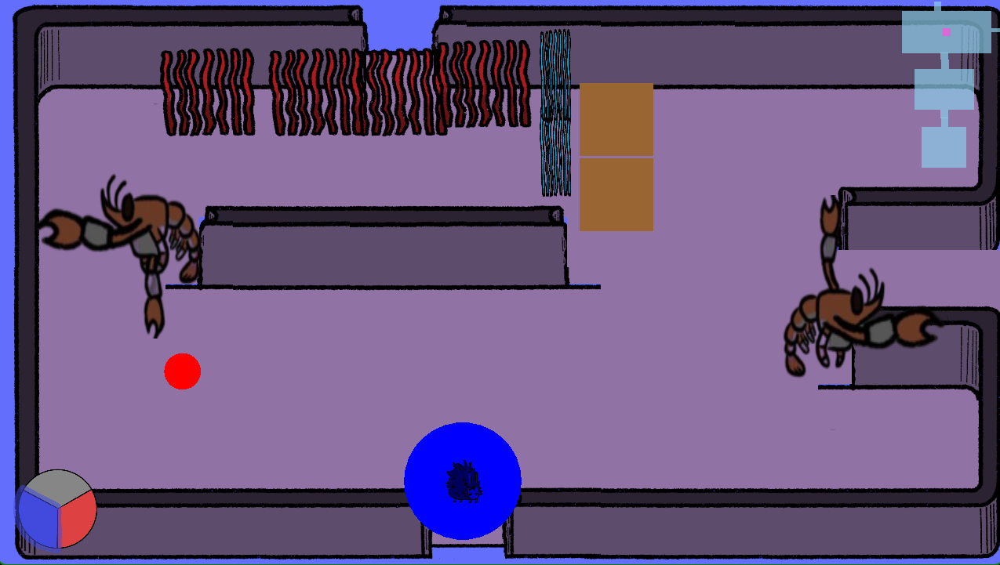
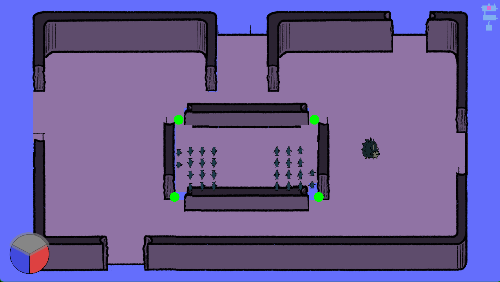
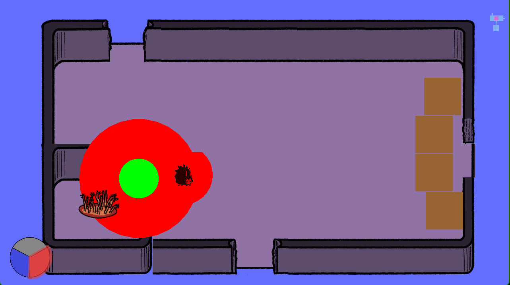

# Team08
# Game
### Team Name: Splash of Hue
### Game Name: Splash of Hue
### Team members: Sophia, Abrielle, Clair/Celeste, Spencer, Geetika

## Concept
Our game is a top-down puzzle based dungeon crawler where the player will find and collect colours that you will be able to emit and use to solve puzzles.
## Setting
A bioluminescent sea creature journeys up to the surface to return to the sun that it has heard legends of and believes it originates from. Along the way, this creature introduces colour and light to a world that has never experienced it before.
## Controls
WASD for up, left, down, right movement. E to open up colour menu. Use arrow keys when colour menu pops up to toggle between different colours and press E again to select colour. Move and collide with other objects to change their colours. 

## Milestone 3
## Milestone Engagement Criteria
- Discovery -> Player can discover new things by moving and exploring rooms, and collide with objects to see what happens.
- Challenge -> Player is stopped by obstacles, like the pistol shrimp, non-passable boxes and walls, dangerous sawfish, and must figure out ways to bypass obstacles and understand AI behaviours, such as sawfish following, charging and pistol shrimp rotation, to traverse the tutorial and enter the final room.
## Milestone Required Elements
- Memory Management: We used Visual Studio's diagnostic tools and Visual Studio's performance profiler and found our game uses about 300 MB of memory, but there were no instances of memory leaks or hoarding. 
- Realtime performance: We profiled the runtime of our systems, and found that the rendering and physics systems were runtime bottlenecks, where the rendering system took about 90% of the time, and the physics system took about 6%. We changed the physics system to use broad pass by checking for an AABB collision and only running mesh collision if that check was successful, which made slight improvements. 
## Milestone Creative Features
- [10] Precise collisions -> Mesh based collisions using seperability axis theorem implemented by Geetika
- [16] Swarm behaviour -> Minnows will swarm and flock to each other and move like a school of fish, implemented by Sophia  using BOIDS, who has also set it up so that simply changing the separation, cohesion, and alignment parameters in the code can vastly change the way the minnows swarm, allowing for different movement patterns. 
- [15] Advanced decision-making -> A* pathfinding implemented by Clair, and decision tree for sawfish and shrimp behaviours implemented by Sophia and Spencer.
- [19] Reloadability -> Loading and unloading levels using LDtk library implemented by Clair
- [26] Numerous sophisticated integrated assets -> Same art style for assets implemented by Clair, Abby and Sophia
## Milestone Screenshots
Minimap and colour menu UI added to tutorial

New dungeon with sliding entities

New dungeon with colour emitting entities

# Docs

- [Test Plan](./doc/test-plan.pdf)
- [Game Proposal](./doc/proposal.pdf)

